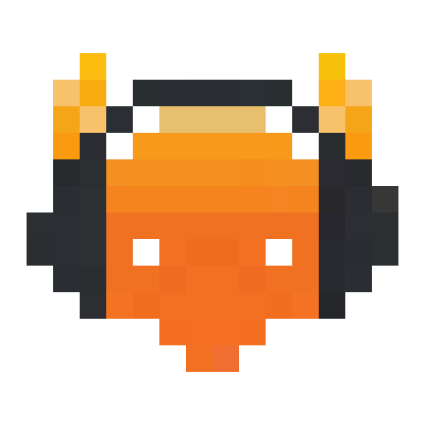

<div align="center">

<h1>Discord-DJBot</h1>
<p>A self-hosted music bot for <a href="https://discord.com/">Discord</a> voice channels, controlled with slash commands and a web interface.</p>

<p>
<a href="LICENSE"></a>
<a href="https://github.com/AidenOfficial/Discord_DJBot/actions/workflows/ci.yml"></a>


</p>

<p><strong>English</strong> · <a href="README.zh-CN.md">简体中文</a></p>
</div>

---

Discord-DJBot joins a voice channel in your Discord server and plays audio from YouTube, Bilibili, Spotify, live streams, internet radio and a local music library. People request songs with slash commands or from a browser-based dashboard, which also provides queue management, personal playlists, cache management and listening statistics.

It is the Discord port of [Mumble-DJBot](https://github.com/AidenOfficial/Mumble-DJBot), itself a fork of the archived [azlux/botamusique](https://github.com/azlux/botamusique). The playback engine, download pipeline and web interface are shared; only the connection layer and the command front end are Discord-specific.

> [!NOTE]
> The bot currently serves **one Discord server**. Commands used in any other server are refused. Multi-server support is planned.

## Table of Contents

- [Features](#features)
- [Requirements](#requirements)
- [Setting up the Discord application](#setting-up-the-discord-application)
- [Installation](#installation)
- [Web Interface and Remote Access](#web-interface-and-remote-access)
- [Security Considerations](#security-considerations)
- [Usage](#usage)
- [Configuration](#configuration)
- [Development](#development)
- [Acknowledgements](#acknowledgements)
- [License](#license)

## Features

### Audio sources

- YouTube, Bilibili (BV identifiers or URLs), SoundCloud and other sites supported by [yt-dlp], including their playlists.
- Spotify tracks, playlists and keyword search, resolved to audio via [spotDL].
- Live streams, internet radio (including [radio-browser.info](https://www.radio-browser.info/) search) and local audio files.

### Playback

- **Stream while downloading.** Playback of long videos starts once roughly 30 seconds of audio is available, and the rest is downloaded in the background.
- **Non-music segment skipping.** Segments marked by the [SponsorBlock] and [BilibiliSponsorBlock] communities, such as spoken intros and sponsor reads, are skipped automatically.
- Queue prefetching, loudness normalization (`loudnorm`), smooth volume changes and stereo Opus output.
- Five playback modes: one-shot, repeat, single-track loop, random and autoplay (random tracks from the library).
- Voice connections use Discord's end-to-end encryption (DAVE), which Discord requires for voice.

### Slash commands

- Every command has typed options, descriptions in English, Simplified Chinese and Japanese (shown in the user's Discord language), and autocomplete for queue entries, playlists, library files, radio presets and tags.
- `/play` takes a song name, a URL or a queue number, and joins your voice channel if the bot is not in one yet.
- Errors and private commands (`/bind`, `/help`, `/web` …) are answered only to you; announcements such as "now playing" go to a channel of your choice.

### Voice channels

- The web interface shows the server's voice channels by category, with who is in each, and lets you move the bot or set a default channel.
- Follow modes: follow the last person who left an empty channel, or always follow a chosen member. AFK channels and other bots are ignored.
- Playback pauses automatically after a configurable idle period (5 minutes by default) and resumes when someone returns. If someone disconnects the bot from voice, it pauses.

### Web interface

- **Now Playing:** high-resolution album artwork and the official song title (looked up on NetEase Cloud Music, iTunes and Deezer, with Shazam as a fallback), a draggable progress bar, and a preparation panel with the estimated start time.
- **Queue:** drag-and-drop reordering, plus unified search across YouTube and Bilibili.
- **Library:** browsing and resumable chunked uploads (up to 4 GB per file by default). Audio is extracted from video files.
- **Cache:** storage use and play counts; frequently played tracks can be pinned or saved to the library.
- **Statistics:** most played tracks, top requesters, busiest hours and most skipped tracks.

### Personal playlists

- Users are identified by the email address that Cloudflare Access passes through, or by their Discord account when they [log in with Discord](#log-in-with-discord), and can set a display alias.
- Each user has their own playlists, which can be played, shuffled or appended to the queue.
- Playlists can be imported from YouTube, NetEase Cloud Music, QQ Music and Spotify.
- A Discord account can be linked to the web identity with a one-time code (`/bind`). Linked users can use their playlists from Discord with `/mylist` and `/fav`.

### Reliability

- A watchdog restarts the process if the main loop stalls for more than 120 seconds, and a heartbeat file supports container health checks.
- discord.py reconnects to the gateway and to voice by itself; failed downloads are resumed and retried.

## Requirements

- A Discord server where you can add a bot (you need the *Manage Server* permission).
- **Docker deployment (recommended):** Docker Engine with Docker Compose. Every runtime dependency is included in the image.
- **Bare-metal deployment:** Python 3.12, FFmpeg and libopus. See [`deploy/DEPLOY.md`](deploy/DEPLOY.md).
- **Optional:** Spotify API credentials, required only for the `/spotify` command (playlists of up to 100 tracks can be imported on the web without them).
- **Optional:** a Cloudflare account, for remote access to the web interface.

## Setting up the Discord application

1. Open the [Discord Developer Portal](https://discord.com/developers/applications) and create a **New Application**.
2. Under **Bot**, click **Reset Token** and copy the token. Treat it like a password: anyone with it controls the bot. No privileged gateway intents are needed; leave *Presence*, *Server Members* and *Message Content* off.
3. Under **OAuth2 → URL Generator**, select the scopes `bot` and `applications.commands`, and the bot permissions *View Channels*, *Send Messages*, *Embed Links*, *Attach Files*, *Read Message History*, *Connect*, *Speak* and *Set Voice Channel Status*. Open the generated URL and add the bot to your server. The equivalent URL is:

   ```text
   https://discord.com/oauth2/authorize?client_id=<APPLICATION_ID>&scope=bot+applications.commands&permissions=281474979974144
   ```

   *Embed Links*, *Attach Files* and *Read Message History* are for the now-playing panel (cover art, progress bar, buttons); *Set Voice Channel Status* shows the current song under the voice channel. If the bot is already in your server, open the new URL once more to grant them.

4. In Discord, enable **Settings → Advanced → Developer Mode**, then right-click your server icon and choose **Copy Server ID**. You will put it in `[discord] guild_id`.

The bot registers its slash commands in that server when it starts, so they appear immediately.

## Installation

### 1. Clone the repository

```bash
git clone https://github.com/AidenOfficial/Discord_DJBot.git
cd Discord_DJBot
```

### 2. Create the configuration and the token file

```bash
cp configuration.example.ini configuration.ini
echo 'DISCORD_TOKEN=<your bot token>' > .env
```

> [!IMPORTANT]
> `configuration.ini` must exist before the container is started. Otherwise Docker creates a directory in its place and the bot cannot read its configuration. `.env` is listed in `.gitignore`; never commit the token.

A minimal configuration is shown below. Any option you leave out falls back to `configuration.default.ini`, which should not be edited.

```ini
[discord]
guild_id = 123456789012345678     ; your server's ID
; channel = Music                 ; voice channel to join on startup (name, Category/Name, or ID)
; announce_channel = 234567890123456789  ; text channel for "now playing" messages

[bot]
admin = 345678901234567890        ; user or role IDs, comma separated; server admins count too
language = en_US                  ; en_US, zh_CN or ja_JP

[webinterface]
enabled = True
listening_addr = 0.0.0.0          ; required inside the container; isolated by the Compose network
```

### 3. Pull and start

The image is built by GitHub Actions and published to `ghcr.io/aidenofficial/discord_djbot` (`edge` tracks `main`). To build from source instead, see `docker-compose.build.yml`.

```bash
docker compose pull
docker compose up -d
docker compose logs -f
```

The bot connects out to Discord, so no ports need to be published. When the log shows `synced NN slash commands`, type `/` in your server to see them, join a voice channel and try `/play` with a song name.

### 4. Keep extractors up to date

On every start, the container upgrades yt-dlp and spotDL (`BAM_UPDATE_ON_START=1`). YouTube and Bilibili change often, so restart the container once a day, for example with a cron entry:

```cron
0 5 * * * docker restart discord-music
```

For NAS deployment, cookies and routine maintenance, see [`deploy/DOCKER.md`](deploy/DOCKER.md).

## Web Interface and Remote Access

The recommended way to expose the web interface is Cloudflare Tunnel with Cloudflare Access. Cloudflare handles authentication, and port 8181 is never published.

1. In the Cloudflare Zero Trust dashboard, create a tunnel. Set its public hostname to point to `http://botamusique:8181`.
2. Create an Access application for the same hostname, with a policy that allows the intended email addresses.
3. Add the tunnel token to `.env` and start the `tunnel` profile:

   ```bash
   echo 'CLOUDFLARE_TUNNEL_TOKEN=<token>' >> .env
   docker compose --profile tunnel up -d
   ```

For detailed instructions, see [`deploy/WEBUI.md`](deploy/WEBUI.md).

### Log in with Discord

The web interface can also sign users in with their Discord account (OAuth2, scopes `identify guilds`). Someone who already linked their account with `/bind` keeps their playlists and favorites. Everyone else gets a new web identity tied to their Discord account, so `/bind` is no longer needed.

1. In the [Developer Portal](https://discord.com/developers/applications), open your application → **OAuth2** and add the redirect `<public_url>/auth/discord/callback` (for example `https://music.example.com/auth/discord/callback`).
2. Copy the **Client ID** and **Client Secret** into `configuration.ini`:

   ```ini
   [webinterface]
   auth_method = discord        ; require Discord login (or keep token/none and use it optionally)
   discord_client_id = <client id>
   discord_client_secret =      ; or set DISCORD_CLIENT_SECRET in .env instead
   public_url = https://music.example.com
   ```

3. Restart the bot. With `auth_method = discord`, unauthenticated pages redirect to Discord, `/api/*` returns 401, and only accounts that are in a server the bot serves are let in. With `auth_method = token`, the token page shows a **Log in with Discord** button as an alternative.

> [!CAUTION]
> The client secret is a credential. Never commit it to git. The `DISCORD_CLIENT_SECRET` environment variable overrides the ini value.

## Security Considerations

> [!WARNING]
> The default `auth_method = none` performs no authentication in the application itself. It relies entirely on Cloudflare Access.

- **Keep the bot token secret.** If it leaks, reset it in the Developer Portal immediately.
- **Do not expose port 8181** to the internet or to untrusted networks.
- **Enable Access JWT verification** by setting `access_team_domain` and `access_aud` under `[webinterface]`, so traffic that bypasses the tunnel cannot impersonate a user.
- **`flask_secret` signs the session cookies** (`token` and `discord` logins). If you leave it unset, a random secret is generated once and kept in the settings database. If you set it, use a long random value.
- Administrators and bans are keyed by Discord user and role IDs, which cannot be spoofed by changing a nickname.

## Usage

### Slash commands

Type `/` in the server to browse every command with its options. `/help` lists them in the bot's language. Commands can be renamed in the `[commands]` section.

| Command | Description |
|---|---|
| `/play [query]` | Play a song name or URL, resume, or (with a number) play that queue entry |
| `/url` / `/bili` / `/spotify` / `/playlist` | Add a URL, a Bilibili video, a Spotify link or search, or a whole playlist |
| `/ysearch` → `/pick` | Search YouTube, then pick results by number |
| `/live` / `/radio` / `/rbquery` / `/rbplay` | Live streams and internet radio |
| `/file` / `/filematch` / `/search` / `/tag` | Local library |
| `/pause` / `/skip` / `/stop` / `/last` | Playback control |
| `/queue` / `/np` / `/remove` / `/shuffle` / `/repeat` / `/clear` | Queue |
| `/mode` / `/volume` | Playback mode and volume |
| `/join` / `/leave` | Join your voice channel / stop and leave |
| `/bind` / `/mylist` / `/fav` | Personal playlists (generate the code in the web interface) |
| `/lyrics` / `/web` / `/help` / `/version` | Other |

Server admins — members with *Administrator* or *Manage Server* (unless `[discord] admin_by_permission = False`) and roles listed in `[bot] admin` — manage their own server with `/maxvolume`, `/userban`, `/userunban`, `/urlban`, `/urlunban` and `/banlist`. Discord shows these only to members with *Manage Server* by default; a server can change that under *Server Settings → Integrations*.

The bot owner — the user IDs in `[bot] admin` — is an admin everywhere and also has the global ban list (`/globalban`, `/globalunban`, `/globalbanlist`, `/urlwhitelist`, `/urlunwhitelist`) and the operations commands (`/kill`, `/update`, `/rescan`, `/dropdatabase`, web user commands). These are registered only in `[discord] owner_guild_id` (or globally, visible to administrators, when it is empty), and the bot checks the owner's ID every time they run.

By default only people in the bot's voice channel can control playback (`[bot] allow_other_channel_message`).

## Configuration

[`configuration.example.ini`](configuration.example.ini) documents every option. The ones most often changed are:

| Option | Default | Description |
|---|---|---|
| `[discord] guild_id` | *(first server)* | The server the bot serves |
| `[discord] channel` | *(none)* | Voice channel to join on startup; the web Settings page overrides it |
| `[discord] announce_channel` | *(last command channel)* | Text channel for announcements |
| `[discord] bitrate` | `0` | Opus bitrate in kbps; `0` follows the voice channel's bitrate |
| `[bot] stream_while_downloading` | `True` | Start long tracks before the download completes |
| `[bot] tmp_folder_max_size` | `4096` | Download cache limit in MB; least recently used entries are evicted first |
| `[bot] max_track_duration` | `0` | Maximum track length in minutes; `0` disables the limit |
| `[bot] sponsorblock` | `True` | Skip non-music segments |
| `[bot] playback_mode` | `one-shot` | Playback mode at startup |
| `[youtube_dl] cookie_file` | *(empty)* | Netscape-format cookies for Bilibili premium content or signed-in YouTube access |

The token can also be passed as the `DISCORD_TOKEN` environment variable (recommended), and `--guild` / `--channel` on the command line override the INI file.

## Development

### Running the tests

The test suite does not connect to Discord.

```bash
python3.12 -m venv venv
venv/bin/pip install -r requirements.txt pytest
venv/bin/python -m pytest tests
```

Python 3.12 is the version the Docker image uses. On 3.13 and later, `requirements.txt` pulls in `audioop-lts`.

### Building the web interface

The dashboard is in `webui/` and is built with Vue 3, TypeScript, Vite and Tailwind CSS 4.

```bash
cd webui
npm ci
npm run dev     # development server; proxies /api to 127.0.0.1:8181
npm run build   # writes the production build to webui/dist
```

`webui/dist` is committed so that deployments without Node.js work. Commit the updated build together with any frontend change.

### Smoke test

`scripts/smoke_test.py` checks the runtime environment (FFmpeg, libopus, DAVE, spotDL, Deno) and the Bilibili and Spotify download paths without connecting to Discord. See [`deploy/VERIFY.md`](deploy/VERIFY.md).

### Continuous integration

| Workflow | Runs on | What it does |
|---|---|---|
| `ci.yml` | push to `main`, pull requests, weekly | Ruff, ShellCheck, Hadolint and actionlint; tests on Python 3.12 and 3.13; the web interface build with a check that `webui/dist` is current; a Docker build with an offline smoke test. `CI OK` is the single check to require. |
| `docker-publish.yml` | push to `main`, `v*` tags | Builds `linux/amd64` and `linux/arm64` images and pushes them to `ghcr.io/aidenofficial/discord_djbot`, with an SBOM, provenance and a Trivy scan. |
| `release.yml` | `v*` tags | Creates a GitHub release with notes grouped by label. |
| `codeql.yml`, `dependency-review.yml`, `pr-triage.yml`, `stale.yml` | various | Code scanning, dependency review, PR labelling and housekeeping. |

### Project structure

| Path | Contents |
|---|---|
| `djbot.py`, `bot/` | Entry point; Discord connection (`discord_link.py`), HTML → Markdown (`discord_format.py`), command dispatch (`core.py`), playback loop (`player.py`), voice channel following (`channels.py`), cache and cleanup |
| `commands/` | Slash command table (`slash.py`), autocomplete and handlers |
| `media/` | Audio sources, the play queue, SponsorBlock, artwork, lyrics |
| `interface.py`, `web_*.py`, `templates/` | Flask application: authentication and the `/api/*` endpoints |
| `webui/` | Web interface source and build output |
| `lang/` | Bot messages (English, Simplified Chinese, Japanese) |
| `deploy/` | Deployment guides and systemd units |
| `tests/` | Unit tests |

## Acknowledgements

This project is based on [botamusique](https://github.com/azlux/botamusique) by Azlux and its contributors, including @TerryGeng and @mertkutay, by way of [Mumble-DJBot](https://github.com/AidenOfficial/Mumble-DJBot). It builds on [discord.py](https://github.com/Rapptz/discord.py), [yt-dlp], [spotDL], [SponsorBlock], [BilibiliSponsorBlock] and [OpenCC](https://github.com/BYVoid/OpenCC).

## License

Released under the [MIT License](LICENSE).

[yt-dlp]: https://github.com/yt-dlp/yt-dlp
[spotDL]: https://github.com/spotDL/spotify-downloader
[SponsorBlock]: https://sponsor.ajay.app/
[BilibiliSponsorBlock]: https://bsbsb.top/
